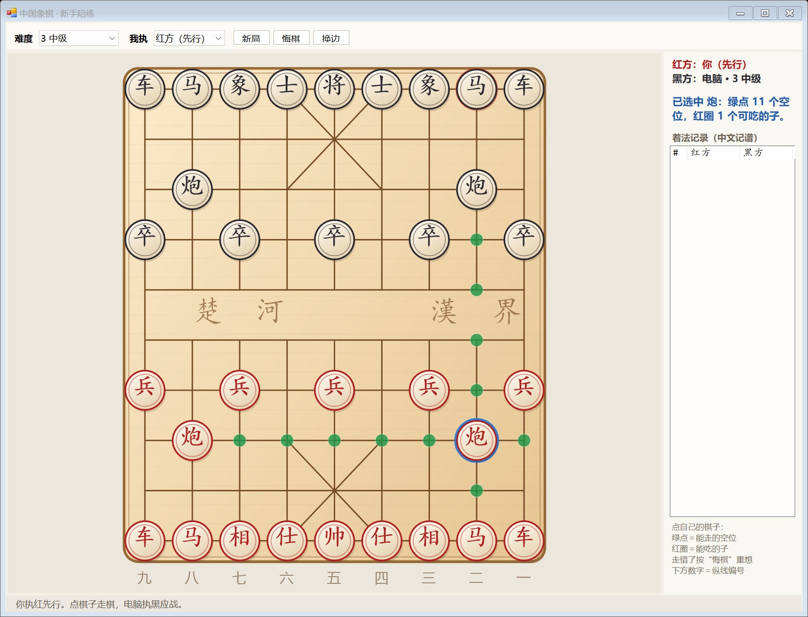

# 中国象棋 · 新手陪练

一个给**象棋初学者**用的单机对弈程序：和电脑下棋、随时悔棋重想、每一步都能看到合法的走法。

**双击 `ChinaChess.exe` 就能玩**，不需要安装任何东西（Windows 自带 .NET Framework 即可运行）。

> **English** — A beginner-friendly Chinese Chess (Xiangqi) trainer for Windows.
> One self-contained `ChinaChess.exe` (no install, no runtime to download) that plays against you
> at 5 difficulty levels, highlights every legal move of the piece you select, and lets you take
> back moves so you can study your own mistakes. Written in pure C# / WinForms with a hand-written
> engine (alpha-beta + transposition table + quiescence search). The rules are verified against the
> known **perft** values `44 / 1920 / 79666 / 3290240`. MIT licensed.



---

## 一、怎么开始

1. 双击 **ChinaChess.exe**
2. 默认你执**红方先行**，电脑执黑
3. **点一下自己的棋子** → 棋盘上出现提示 → **点绿点**把棋子走过去

## 二、棋盘上的提示（专为初学者设计）

| 视觉提示 | 含义 |
| --- | --- |
| 🔵 蓝色圆圈 | 你当前选中的棋子 |
| 🟢 绿色圆点 | 这个子**能走到的空位**（只会显示合法着法） |
| 🔴 红色圆圈 | 这个子**能吃掉对方的哪个子** |
| 🟡 黄色光圈 | 上一步走的是哪个子、走到了哪里 |
| 💗 红色闪环 | 这一方的将/帅**正在被将军**，必须马上解将 |

不合规则的着法根本点不下去（走棋会送将、将帅会照面时，程序直接不让你走），所以**你不可能下出违规棋**。

## 三、难度

| 难度 | 水平 | 每步思考 |
| --- | --- | --- |
| 1 入门 | 会吃子，但经常看走眼、会送子 | 很快 |
| 2 初级 | 会吃子，偶尔失误 | 很快 |
| 3 中级 | 能算 3 步，不送子 | 约 0.1 秒 |
| 4 高级 | 能算 4 步，会抓漏着 | 约 0.2～2 秒 |
| 5 大师 | 能算 5～6 步，会算杀棋 | 最多 5 秒 |

**建议路径**：先在「1 入门」熟悉规则和吃子，能稳定赢之后再往上加一档。

## 四、按钮

- **新局**：重新开始一盘
- **悔棋**：退回上一步（会一次退回你和电脑各一步，重新轮到你走）。电脑正在思考时按也有效，会立刻中止思考
- **换边**：改执黑后行，电脑执红先行；棋盘会自动翻转，你的子永远在下方
- **我执**：直接切换执红/执黑
- **难度**：随时可改，立刻生效，不用重开

## 五、右侧棋谱记录

用标准中文记谱法记录每一步，和你买的棋谱书格式一致：

```
1  炮二平五   马8进7
2  马二进三   车9平8
```

- **红方用中文数字**（一～九），**黑方用阿拉伯数字**（1～9），这是棋谱惯例
- 同一纵线上有两个同种棋子时自动写成「前车」「后炮」
- 棋盘下方的数字就是纵线编号，红方从右往左数一～九，黑方从右往左数 1～9，与记谱一一对应

学会了看这一列，你就能看懂棋书上的着法了。

## 六、已实现的象棋规则

- 车走直线、马走日（**蹩马腿**）、象走田（**塞象眼**，且不过河）
- 士走斜线（限九宫）、将帅走直线（限九宫）
- 炮走直线、吃子必须**隔一个炮架翻山**
- 兵/卒只能向前，**过河后可以横走**，永不后退
- **将帅不能照面**（同一纵线中间无子时不许走成这种局面）
- **不许送将**：任何让自己将帅被吃的着法都是非法着法
- **将死**判负；**困毙**（没有着法可走，但未被将军）在中国象棋里同样**判负**
- 同一局面出现 3 次判和；连续 60 回合无吃子判和

规则正确性用 **perft**（走法生成计数）验证过，与公认数值完全一致：

```
perft(1) = 44         perft(2) = 1920
perft(3) = 79666      perft(4) = 3290240
```

## 七、给初学者的练棋建议

1. **先别急着进攻**，用「入门」难度练到能看懂每个子怎么走
2. **每次被吃子就按悔棋**，回到上一步，看看是不是有子没保护、或者走开后露出了将帅
3. **盯住"将军"提示**：被将军只有三种解法——走将、垫子、吃掉将军的子
4. **记住开局三原则**：先出车马炮、别用一两个子孤军深入、将帅别乱动
5. **换边下**：执黑后行能逼你学会应对红方的进攻
6. 每盘结束后看右侧棋谱，把走错的几步重走一遍

## 八、文件结构

```
ChinaChess.exe        ← 双击这个开始玩（单文件，约 90 KB）
build.ps1             ← 一键重新编译 + 跑自测
push-to-github.ps1    ← 一键推送到 GitHub
README.md / LICENSE   ← 说明与授权（MIT）
assets/icon.ico       ← 程序图标
shots/                ← 界面截图
src/Xiangqi.cs        ← 棋盘、走法生成、将军判定、中文记谱
src/Engine.cs         ← 电脑棋手（Alpha-Beta 搜索 + 置换表 + 局面评估）
src/BoardControl.cs   ← 棋盘绘制与鼠标交互
src/MainForm.cs       ← 主窗口、对局流程、悔棋/换边/难度
src/Program.cs        ← 入口
tools/SelfTest.cs     ← 自测：perft / 记谱 / 引擎战术
tools/make_icon.py    ← 生成图标
```

## 九、重新编译（需要改代码时）

```powershell
powershell -ExecutionPolicy Bypass -File build.ps1
```

脚本会用 Windows 自带的 .NET Framework 编译器编译出 `ChinaChess.exe`，然后自动运行自测（perft 走法计数、中文记谱、战术吃子、绝杀/困毙判定、40 回合自我对弈）。

## 十、技术说明

- **界面**：WinForms + GDI+ 手绘棋盘，单文件 exe，无需安装运行时
- **电脑棋手**：Negamax + Alpha-Beta 剪枝 + 置换表（Zobrist 哈希）+ 静态搜索（吃子延伸，避免"看到吃子就算完"的低级失误）+ 着法排序（置换表着法 / MVV-LVA / 杀手着法 / 历史启发）
- **局面评估**：子力价值 + 兵的前进奖励 + 马炮车的中心与过河奖励 + 靠近对方九宫的威胁奖励 + 将帅安全
- **难度差异**：通过搜索深度、思考时间、以及「评估噪声」和「随机漏着概率」共同实现——低难度不是随便乱走，而是"看得浅 + 会看走眼"，更像真人初学者
- **不卡界面**：电脑在后台线程思考，随时可按悔棋中止；每步思考有严格时间上限
